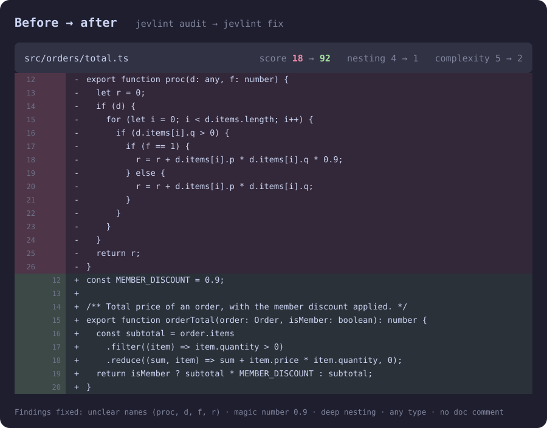

<p align="center">
  <b>日本語</b> · <a href="README.zh-CN.md">简体中文</a> · <a href="README.md">English</a>
</p>

<p align="center">
  <a href="#今すぐ試す"></a>
</p>

<p align="center">
  <a href="https://www.npmjs.com/package/@indxjp/jevlint"></a>
  <a href="https://github.com/INDXDev/jevlint/actions/workflows/ci.yml"></a>
  
  
  <a href="LICENSE"></a>
</p>

<p align="center">
  <a href="docs/getting-started.md"><b>はじめに</b></a> &nbsp;·&nbsp;
  <a href="docs/cli.md"><b>CLI</b></a> &nbsp;·&nbsp;
  <a href="docs/presets.md"><b>プリセット</b></a> &nbsp;·&nbsp;
  <a href="docs/agents.md"><b>コーディングエージェント</b></a> &nbsp;·&nbsp;
  <a href="docs/README.md"><b>ドキュメント</b></a>
</p>

# jevlint

**最初にリファクタリングすべき箇所を示す、モデルベースのリンターです。**

ESLint は、ある行がルールに違反したことを教えてくれます。jevlint はリポジトリ内のすべてのファイルを読み、
選んだ原則に照らしてどれだけクリーンかをスコア化し、ランキングを返します。最も乱雑で、最も頻繁に
変更されるファイルが先頭です。さらに、Claude Code や Codex に修正させるためのプロンプトも生成します。

<p align="center">
  
</p>

<p align="center"><sub>架空のファイルによる説明用の例です。</sub></p>

## 今すぐ試す

インストールも API キーも不要で、コードは手元のマシンから出ません。

```sh
npx @indxjp/jevlint --ast-only
```

## インストール

```sh
npm install -g @indxjp/jevlint     # または: pnpm add -g @indxjp/jevlint
jevlint --version
```

Node.js 24.22.1 以降が必要です（22 系なら 22.23.4、26 系なら 26.12.1 以降）。

## 動作例

あるチームが `shop-api` を引き継ぎ、整理に使える時間は午後だけです。jevlint は対象のファイルを選び、
その理由を説明し、Claude Code に渡し、スコアが上がったことを確認します。

<p align="center">
  
</p>

<p align="center"><sub>架空のプロジェクトでのシミュレーション実行です。<a href="docs/assets/demo/demo.tape">録画スクリプト</a>。</sub></p>

## 何が違うのか

- **2 種類の判定。** 複雑度やネストのように測定できるものは AST 解析で測ります。
  「この名前は意味を持っているか」のように判断が必要なものには
  [デシジョンモデル](docs/concepts.md#decision-models)が答えます。
- **チャットボットではなくデシジョンモデル。** [TypeSafe AI の Jev](https://typesafe.ai) のようなモデルは、
  文章ではなく較正されたスコアと確率を返します。そのため高速かつ低コストで、結果をランク付けし、キャッシュできます。
- **警告の山ではなくランキング。** ファイルは乱雑さ、git の変更頻度、サイズの順に並ぶため、
  先頭の項目が時間をかける価値のあるものです。
- **リポジトリ全体だけでなく変更もレビュー。** `jevlint pr` と `jevlint commits` は、ファイルの
  変更前後のスコアと、その変更で悪化した点だけを表示します。`--intent` を付けると、変更をそのメッセージや
  `AGENTS.md` とも照合します。
- **独自ルールを 1 文で。** ast-grep のパターンで対象のコードを選び、yes/no の質問で各マッチを
  判定するため、モデルの判定に行番号が付きます。
- **主要なソース言語のほとんどに対応。** TypeScript、JavaScript、Python、Go、Rust は正確なメトリクスを
  取得できます。その他の言語は追加のインストールなしで[近似値](docs/scoring.md#languages-without-a-grammar)を取得できます。
- **原則をプリセットとして。** 著名なソフトウェア書籍の考え方に照らして監査することも、
  数行の TOML で独自のプリセットを書くこともできます。
- **確定できるスコア。** `jevlint-score` コメントで、受け入れたスコアを理由とともに固定できるため、
  誰も点数を追いかけずに済みます。[スコアの固定](docs/scoring.md#pinning-scores)を参照してください。
- **コーディングエージェントにすぐ使える。** `jevlint prompt | claude -p` を使うか、`jevlint fix` にエージェントを実行させます。
  [Claude Code プラグイン](#コーディングエージェントで修正する)と編集フックが付属しています。
- **同じ回答への支払いは 1 回だけ。** 結果は内容をキーにキャッシュされ、
  [S3 互換バケット](docs/caching.md#share-the-cache-through-object-storage)を使えば CI やチームで共有できます。

## jevlint ではないもの

- **既存のリンターの代わりではありません。** 厳密に判定できることには、引き続き ESLint、Ruff、Clippy、
  型チェッカーを使ってください。jevlint は、それらでは判断できないものをランク付けします。
- **最終判定ではありません。** モデルのスコアは較正された意見です。モデルによって異なり、モデルの
  バージョン間で変わることもあります。人がレビューする候補として扱い、CI ではモデルのバージョンを固定し、
  [`jevlint test`](docs/presets.md#testing-a-question) で質問の結果がずれたときに検知してください。
- **プロバイダーを有効にすると、デフォルトではプライベートではありません。** `--ast-only` 以外はすべて、
  設定したプロバイダーにコードを送信します。[実行する前に](#実行する前に)を参照してください。

## クイックスタート

```sh
jevlint auth set typesafe   # キーをユーザーごとに一度だけ保存する
jevlint init                # このリポジトリに jevlint.toml を作成する
jevlint audit --dry-run     # プロバイダーへのリクエストなしで、送信される内容を確認する
jevlint audit               # コードベース全体をランク付けする
```

TypeSafe を利用できない場合は、`openai`、`cloudflare`、`gateway` などの
[別のプロバイダーを使用](docs/providers.md)してください。

## コーディングエージェントで修正する

```sh
jevlint prompt --top 3 --copy      # 任意のエージェントに貼り付ける
jevlint prompt | claude -p         # またはパイプで渡す
jevlint fix --agent claude         # またはエージェントを実行し、再スコアする
```

Claude Code では、プラグインをインストールすると、スキルと `/jevlint:audit`、`/jevlint:explain`、
`/jevlint:review` が使えます。編集フックは、有効にするまでオフです。

```text
/plugin marketplace add INDXDev/jevlint
/plugin install jevlint@jevlint
```

[コーディングエージェント](docs/agents.md)を参照してください。

## ドキュメントとコードの整合を保つ

`jevlint spec` はドキュメントをチェックリストに変換し、それに照らしてコードとドキュメントを検査します。

```sh
jevlint spec compile --copy   # エージェント向けのプロンプト: ドキュメントから .jevlint/spec を書く
jevlint spec check            # どのファイルが項目に違反し、どの項目が未実装か
jevlint spec drift            # ドキュメントとチェックリストが食い違う箇所
```

チェックリストは 2 階層の YAML で、プロジェクト全体のチェックリストと、機能ごとのチェックリストから
なります。各ファイルはまず該当する機能に振り分けられ、その機能の項目だけで判定されます。
[仕様駆動開発](docs/spec-driven-development.md)を参照してください。

## 独自ルールを書く

ast-grep のパターンで、どのコードを対象にするかを決めます。1 つの質問で、それが問題かどうかを判定し、
yes なら違反です。検出結果はそれぞれの行に報告されます。

```toml
# jevlint.toml
[[rules]]
id = "catch-hides-failure"
language = "typescript"
pattern = "try { $$$ } catch ($E) { $$$ }"
question = "Does this catch block swallow a failure the caller needed to know about?"
message = "This catch hides a failure"
fix = "Rethrow it, or return an error the caller must handle."
threshold = 0.8   # 任意: この確率以上で報告する
```

マッチ 1 件につきプロバイダーへのリクエストが 1 回発生し、上限はルールとファイルごとに
`max_rule_matches` 件です。`--ast-only` ではルールはスキップされます。
[セマンティックルール](docs/presets.md#semantic-rules)を参照してください。

プリセットの質問が機能することを `good-*` と `bad-*` のフィクスチャで確認し、
モデルの更新で結果が変わったことを検知できます。

```sh
jevlint test            # すべてのフィクスチャが正しい側に判定されること
jevlint test --record   # 今日の回答を保存する
jevlint test --drift    # もう一度問い合わせ、変わったものを一覧表示する
```

## 変更をレビューする

```sh
jevlint pr --ast-only                # このブランチのプルリクエストで悪化した点
jevlint pr 42 --ast-only             # 同じことを番号で指定して
jevlint commits --count 5 --ast-only # 同じことをコミットごとに
jevlint commits --count 5 --intent   # 各メッセージと AGENTS.md も差分と照合する
```

作業ツリーはそのまま保たれ、適用されるのは変更側ではなく自分の設定です。`--intent` はリポジトリの指示を
ベースコミットから読み込むため、変更が自分の判定基準を書き換えることはできません。
[CLI リファレンス](docs/cli.md#jevlint-pr-number)を参照してください。すべてのプルリクエストで実行するには
[継続的インテグレーション](docs/ci.md#review-what-a-pull-request-changes)を参照してください。

コミット前に、キーもネットワークも使わずにリグレッションを検出できます。

```sh
jevlint init --pre-commit   # HEAD よりファイルを悪化させるコミットを止める
```

## スコアが低いときに CI を失敗させる

```toml
# jevlint.toml
[scoring]
fail_under = 60    # これを下回ると exit 1
```

レガシーなコードベースでは、スコアではなく新たに生じた問題でゲートを設けます。

```sh
jevlint baseline --ast-only                      # .jevlint/baseline.json をコミットする
jevlint audit --new --ast-only --format github   # 新しい問題があれば exit 1、PR のアノテーションとして出力
jevlint audit --ast-only --format sarif > jevlint.sarif   # コードスキャン用
```

[CI](docs/ci.md) を参照してください。

## 関連プロジェクト

Jev の登場によってリンターは作るべきものとして明白になり、何人かがそれぞれ独自に作りました。以下はいずれも
このプロジェクトとは無関係です。答える問いがそれぞれ異なるため、必要に応じて選んでください。

| プロジェクト | 判定の単位 | こんなときに |
| --- | --- | --- |
| **@indxjp/jevlint**（このプロジェクト） | ファイル全体をランク付け。任意でマッチごとのルール | リポジトリ全体で、名前の付いた原則に照らして、最初に何をリファクタリングすべきか知りたい |
| [jev-lint](https://github.com/mizchi/jev-lint) | ast-grep のマッチ 1 件に 1 文 | 調整済みのしきい値を持つ大量の同梱ルールで、自身のコメントや名前と矛盾するコードを見つけたい |
| [@hazymoon/jevlint](https://github.com/Ice-Hazymoon/jevlint) | 質問ごとに 1 ルール、TypeScript の設定で記述 | 除外設定付きの手書きのレビュールールと、再現率を測るミューテーションテストが欲しい |
| [@phox-js/jevlint](https://github.com/Fox-Islam/jevlint) | Jev のクエリ | コードではなく、Jev に送るクエリをリントしたい。PHP と Python にも対応 |
| [@diffpal/jevlint](https://www.npmjs.com/package/@diffpal/jevlint)、現在は [LintPal](https://github.com/diffpal/lintpal) | Git の比較における変更行 | チームの Markdown ルールをプルリクエストのチェックとして使いたい |

このプロジェクトのベースライン、SARIF 出力、フィクスチャ、ドリフト検査、メッセージ検査は、上の最初の
2 つのプロジェクトに倣ったものです。jevlint、jev-lint、@hazymoon/jevlint はいずれもコードの読み取りに
[ast-grep](https://ast-grep.github.io) を使っています。

## リファレンス

<details>
<summary><b>コマンド</b></summary>

| コマンド | 内容 |
| --- | --- |
| `jevlint audit [paths...]` | ファイルをスコア化してランク付けします。デフォルトのコマンドでもあります。 |
| `jevlint explain <file>` | 1 つのファイルのすべての指摘とスコアを表示します。 |
| `jevlint architecture [paths...]` | コードベース、ディレクトリ、クラスをレビューし、悪い順にランク付けします。 |
| `jevlint pr [number]` | GitHub のプルリクエストの変更をレビューします。変更前後のスコアと、悪化した点を表示します。 |
| `jevlint commits [revision]` | コミットを同じ方法で、`HEAD` からさかのぼって 1 つずつレビューします。 |
| `jevlint baseline [paths...]` | 現時点の問題を記録し、`audit --new` が新しい問題だけを報告するようにします。 |
| `jevlint test [questions...]` | プリセットのフィクスチャを実行し、回答を記録し、ドリフトを検出します。 |
| `jevlint hook` | 編集やステージされた変更で悪化した点を報告します。エージェントと pre-commit 向けです。 |
| `jevlint spec compile\|check\|drift\|list` | 仕様駆動開発。ドキュメントをチェックリストにコンパイルし、それに照らしてコードとドキュメントを検査します。 |
| `jevlint prompt [files...]` | コーディングエージェント向けの修正プロンプトを出力、またはコピーします。 |
| `jevlint fix [files...] --agent <name>` | 最も悪いファイルにエージェントを実行し、再スコアします。 |
| `jevlint init` | リポジトリ設定またはユーザー設定を作成します。 |
| `jevlint auth set\|list\|remove\|env` | API キーを管理します。 |
| `jevlint preset [list\|show\|default\|new\|edit\|add\|remove]` | 原則プリセットを選択、表示、作成、管理します。引数なしではメニューを開きます。 |
| `jevlint cache info\|clear` | 結果のキャッシュを確認、または消去します。 |
| `jevlint config show\|path` | マージされた設定と、その出所を表示します。 |

</details>

<details>
<summary><b>設定</b></summary>

```toml
# jevlint.toml
presets = ["readable-code", "solid"]
include = ["src/**"]
exclude = ["**/*.generated.ts"]

[provider]
name = "typesafe"
model = "jev-latest"

[scoring]
scale = 100        # 0 から 1 のスコアにするには 1 を指定する
fail_under = 60    # これを下回ると exit 1（CI 向け）

[weights]
"readable-code.naming" = 3   # これをより重視する
"solid.dependency-inversion" = 0   # これを無効にする
```

</details>

<details>
<summary><b>組み込みプリセット</b></summary>

| プリセット | 重点 |
| --- | --- |
| `full` | デフォルト。以下のすべてのプリセットで、ファイルごとに 1 リクエスト、97 問 |
| `readable-code` | 名前、コメント、制御フロー、理解にかかる時間 |
| `clean-code` | 小さな関数、単一の抽象化レベル、誠実なエラー処理 |
| `solid` | オブジェクト指向設計の 5 原則 |
| `software-design` | 深いモジュール、情報隠蔽、複雑さの管理 |
| `code-smells` | 古典的なリファクタリングの「コードの臭い」 |
| `clean-architecture` | 依存の方向、境界、フレームワークからの独立 |
| `kiss-dry-yagni` | 簡潔さ、重複、投機的なコード |
| `security` | 入力検証、インジェクション、シークレット、アクセスチェック、安全な失敗 |
| `documentation` | ファイルの目的、公開コードのドキュメントコメント、明示された契約、正確なドキュメント |
| `bug-hunt` | CWE などの分類から集めた 43 種の既知の欠陥クラスで、バグが潜む場所をランク付け |

プリセットは、公に議論されている原則を独自の言葉で言い換えたものです。原著者や出版社とは無関係であり、
その承認を受けたものでもありません。[docs/presets.md](docs/presets.md) を参照してください。

</details>

## ドキュメント

まずは[ドキュメント索引](docs/README.md)からどうぞ。

- [はじめに](docs/getting-started.md)
- [コンセプト](docs/concepts.md)
- [CLI リファレンス](docs/cli.md)
- [設定](docs/configuration.md)
- [プロバイダー](docs/providers.md)
- [プリセット](docs/presets.md)
- [スコアリング](docs/scoring.md)
- [アーキテクチャレビュー](docs/architecture-review.md)
- [仕様駆動開発](docs/spec-driven-development.md)と[仕様リファレンス](docs/spec-reference.md)
- [コーディングエージェント](docs/agents.md)
- [キャッシュ](docs/caching.md)
- [継続的インテグレーション](docs/ci.md)
- [JSON 出力](docs/json-output.md)
- [セキュリティとプライバシー](docs/security.md)
- [トラブルシューティング](docs/troubleshooting.md)
- [アーキテクチャ](docs/architecture.md)と[コードリファレンス](docs/code-reference.md)

## 実行する前に

監査では、ソースファイルの内容が設定したプロバイダーに送信されます。コードが機密である場合は、先に
[セキュリティとプライバシー](docs/security.md)をお読みください。`audit --ast-only` はネットワークに
一切アクセスしません。

## コントリビュート

[CONTRIBUTING.md](CONTRIBUTING.md) を参照してください。脆弱性の報告については [SECURITY.md](SECURITY.md) を参照してください。

## ライセンス

[MIT](LICENSE)

jevlint は独立したオープンソースプロジェクトです。TypeSafe AI、Cloudflare、Microsoft、OpenAI、Vercel、
Anthropic とは無関係であり、その承認を受けたものでもありません。すべての製品名は、それぞれの所有者に帰属します。
