<p align="center">
  <a href="#try-it-now"></a>
</p>

<p align="center">
  <a href="https://www.npmjs.com/package/@indxjp/jevlint"></a>
  <a href="https://github.com/INDXDev/jevlint/actions/workflows/ci.yml"></a>
  
  
  <a href="LICENSE"></a>
</p>

<p align="center">
  <a href="docs/getting-started.md"><b>Get started</b></a> &nbsp;·&nbsp;
  <a href="docs/cli.md"><b>CLI</b></a> &nbsp;·&nbsp;
  <a href="docs/presets.md"><b>Presets</b></a> &nbsp;·&nbsp;
  <a href="docs/agents.md"><b>Coding agents</b></a> &nbsp;·&nbsp;
  <a href="docs/README.md"><b>Docs</b></a>
</p>

# jevlint

**A model-based linter that tells you what to refactor first.**

ESLint tells you a line broke a rule. jevlint reads every file in your repository, scores how
clean it is against principles you choose, and hands you a ranked list: messiest and most-changed
files first. Then it writes the prompt that gets Claude Code or Codex to fix them.

## Try it now

No install, no API key, and your code stays on your machine:

```sh
npx @indxjp/jevlint --ast-only
```

## Install

```sh
npm install -g @indxjp/jevlint     # or: pnpm add -g @indxjp/jevlint
jevlint --version
```

Requires Node.js 24.22.1 or later (or 22.23.4, or 26.12.1, on those lines).

## See it work

A team inherits `shop-api` and has one afternoon for cleanup. jevlint picks the file, explains why,
hands it to Claude Code, and confirms the score went up.

<p align="center">
  
</p>

<p align="center"><sub>Simulated run on a fictional project. <a href="docs/assets/demo/demo.tape">Recording script</a>.</sub></p>

## Why it is different

- **Two kinds of judgement.** AST analysis measures what is measurable, such as complexity and
  nesting. A [decision model](docs/concepts.md#decision-models) answers what needs judgement, such
  as "do these names carry meaning?"
- **Decision models, not chatbots.** Models like [TypeSafe AI's Jev](https://typesafe.ai) return
  calibrated scores and probabilities rather than prose. That makes them fast and cheap, and it means results can be ranked and cached.
- **A ranking, not a wall of warnings.** Files are ordered by mess, git churn and size, so the
  first item is the one worth your time.
- **Reviews of a change, not only a repository.** `jevlint pr` and `jevlint commits` show a file's
  score before and after, and only what the change made worse. `--intent` also holds a change
  against its message and your `AGENTS.md`.
- **Your own rules, in one sentence.** An ast-grep pattern picks the code and a yes/no question
  judges each match, so a model's verdict gets a line number.
- **Most source languages.** TypeScript, JavaScript, Python, Go and Rust get exact metrics. Other
  languages get [approximate ones](docs/scoring.md#languages-without-a-grammar), with no extra install.
- **Principles as presets.** Audit against ideas from well-known software books, or write your own
  in a few lines of TOML.
- **Scores you can settle.** A `jevlint-score` comment fixes an accepted score with a reason, so
  nobody chases points. See [Pinning scores](docs/scoring.md#pinning-scores).
- **Ready for coding agents.** `jevlint prompt | claude -p`, or let `jevlint fix` run the agent.
  A [Claude Code plugin](#fix-it-with-a-coding-agent) and an edit hook are included.
- **Pay for an answer once.** Results are cached by content, and an
  [S3-compatible bucket](docs/caching.md#share-the-cache-through-object-storage) shares them across CI
  and your team.

## What it is not

- **Not a replacement for your linter.** Keep ESLint, Ruff, Clippy and your type checker for what
  they can decide exactly. jevlint ranks what they cannot judge.
- **Not a verdict.** Model scores are calibrated opinions. They vary between models and can move
  between model versions, so treat them as candidates for a person to review, pin a model version
  in CI, and use [`jevlint test`](docs/presets.md#testing-a-question) to see when a question drifts.
- **Not private by default, once a provider is on.** Everything except `--ast-only` sends code to
  the provider you configure. See [Before you run it](#before-you-run-it).

## Quick start

```sh
jevlint auth set typesafe   # store a key once, per user
jevlint init                # create jevlint.toml in this repository
jevlint audit --dry-run     # see what would be sent, with no provider requests
jevlint audit               # rank the whole codebase
```

No TypeSafe access? [Use another provider](docs/providers.md), such as `openai`, `cloudflare` or
`gateway`.

## Fix it with a coding agent

```sh
jevlint prompt --top 3 --copy      # paste into any agent
jevlint prompt | claude -p         # or pipe it
jevlint fix --agent claude         # or run the agent, then re-score
```

In Claude Code, install the plugin for a skill and `/jevlint:audit`, `/jevlint:explain` and
`/jevlint:review`. Its edit hook is off until you turn it on:

```text
/plugin marketplace add INDXDev/jevlint
/plugin install jevlint@jevlint
```

See [Coding agents](docs/agents.md).

## Write your own rule

An ast-grep pattern decides which code is looked at. One question decides whether it is a problem,
and yes means a violation. Each hit is reported on its line:

```toml
# jevlint.toml
[[rules]]
id = "catch-hides-failure"
language = "typescript"
pattern = "try { $$$ } catch ($E) { $$$ }"
question = "Does this catch block swallow a failure the caller needed to know about?"
message = "This catch hides a failure"
fix = "Rethrow it, or return an error the caller must handle."
threshold = 0.8   # optional: report at or above this probability
```

Each match is one provider request, up to `max_rule_matches` per rule and file, and `--ast-only` skips
rules. See [Semantic rules](docs/presets.md#semantic-rules).

Prove a preset question works with `good-*` and `bad-*` fixtures, and catch a model update that
moves it:

```sh
jevlint test            # every fixture must land on the right side
jevlint test --record   # save today's answers
jevlint test --drift    # ask again, and list what moved
```

## Review a change

```sh
jevlint pr --ast-only                # what this branch's pull request made worse
jevlint pr 42 --ast-only             # the same, by number
jevlint commits --count 5 --ast-only # the same, commit by commit
jevlint commits --count 5 --intent   # also check each message and AGENTS.md against the diff
```

Your working tree stays as it is, and your own config applies, not the change's. `--intent` reads
the repository's instructions from the base commit, so a change cannot rewrite what it is judged by.
See the [CLI reference](docs/cli.md#jevlint-pr-number), and
[Continuous integration](docs/ci.md#review-what-a-pull-request-changes) to run it on every pull request.

Catch a regression before it is committed, with no key and no network:

```sh
jevlint init --pre-commit   # stops a commit that makes a file worse than HEAD
```

## Fail CI on a low score

```toml
# jevlint.toml
[scoring]
fail_under = 60    # exit 1 below this
```

On a legacy codebase, gate on what is new instead of on the score:

```sh
jevlint baseline --ast-only                      # commit .jevlint/baseline.json
jevlint audit --new --ast-only --format github   # exit 1 on anything new, as PR annotations
jevlint audit --ast-only --format sarif > jevlint.sarif   # for code scanning
```

See [CI](docs/ci.md).

## Related projects

Jev made a linter an obvious thing to build, and several people built one independently. None of
these is affiliated with this project. They answer different questions, so pick by what you need:

| Project | Unit of judgement | Use it when you want |
| --- | --- | --- |
| **@indxjp/jevlint** (this one) | Whole files, ranked. Optional per-match rules | To know what to refactor first, across a repository, against named principles |
| [jev-lint](https://github.com/mizchi/jev-lint) | One ast-grep match, one sentence | A large catalogue of shipped rules with fitted cutoffs, for code that contradicts its own comments and names |
| [@hazymoon/jevlint](https://github.com/Ice-Hazymoon/jevlint) | A rule per question, in a TypeScript config | Hand-written review rules with exemptions, and mutation tests that measure recall |
| [@phox-js/jevlint](https://github.com/Fox-Islam/jevlint) | A Jev query | To lint the queries you send to Jev, not your code. Also for PHP and Python |
| [@diffpal/jevlint](https://www.npmjs.com/package/@diffpal/jevlint), now [LintPal](https://github.com/diffpal/lintpal) | Changed lines in a Git comparison | Your team's Markdown rules as pull request checks |

Baselines, SARIF output, fixtures, drift checks and message checks here follow the lead of the
first two projects above. jevlint, jev-lint and @hazymoon/jevlint all use
[ast-grep](https://ast-grep.github.io) to read code.

## Reference

<details>
<summary><b>Commands</b></summary>

| Command | What it does |
| --- | --- |
| `jevlint audit [paths...]` | Score files and rank them. Also the default command. |
| `jevlint explain <file>` | Show every finding and score for one file. |
| `jevlint architecture [paths...]` | Review the codebase, directories and classes, and rank them worst to best. |
| `jevlint pr [number]` | Review what a GitHub pull request changes: scores before and after, and what got worse. |
| `jevlint commits [revision]` | Review commits the same way, one by one, from `HEAD` backwards. |
| `jevlint baseline [paths...]` | Record today's issues, so `audit --new` reports only what is new. |
| `jevlint test [questions...]` | Run preset fixtures, record their answers, and detect drift. |
| `jevlint hook` | Report what an edit or a staged change made worse, for agents and pre-commit. |
| `jevlint prompt [files...]` | Print or copy a fix prompt for a coding agent. |
| `jevlint fix [files...] --agent <name>` | Run an agent on the worst files, then re-score them. |
| `jevlint init` | Create a repository or user config. |
| `jevlint auth set\|list\|remove\|env` | Manage API keys. |
| `jevlint preset [list\|show\|default\|new\|edit\|add\|remove]` | Choose, view, write and manage principle presets. Alone, it opens a menu. |
| `jevlint cache info\|clear` | Inspect or empty the result cache. |
| `jevlint config show\|path` | Show the merged config and where it came from. |

</details>

<details>
<summary><b>Configuration</b></summary>

```toml
# jevlint.toml
presets = ["readable-code", "solid"]
include = ["src/**"]
exclude = ["**/*.generated.ts"]

[provider]
name = "typesafe"
model = "jev-latest"

[scoring]
scale = 100        # use 1 for scores from 0 to 1
fail_under = 60    # exit 1 below this, for CI

[weights]
"readable-code.naming" = 3   # care about this more
"solid.dependency-inversion" = 0   # turn this off
```

</details>

<details>
<summary><b>Built-in presets</b></summary>

| Preset | Focus |
| --- | --- |
| `full` | The default: every preset below, 97 questions in one request per file |
| `readable-code` | Names, comments, control flow, time to understand |
| `clean-code` | Small functions, one level of abstraction, honest error handling |
| `solid` | The five object-oriented design principles |
| `software-design` | Deep modules, information hiding, complexity management |
| `code-smells` | Classic refactoring smells |
| `clean-architecture` | Dependency direction, boundaries, framework independence |
| `kiss-dry-yagni` | Simplicity, duplication, speculative code |
| `security` | Input validation, injection, secrets, access checks, safe failure |
| `documentation` | File purpose, doc comments on public code, stated contracts, accurate docs |
| `bug-hunt` | 43 known defect classes, from CWE and other taxonomies, to rank where bugs hide |

Presets paraphrase publicly discussed principles in our own words. They are not affiliated with or
endorsed by the original authors or publishers. See [docs/presets.md](docs/presets.md).

</details>

## Documentation

Start with the [documentation index](docs/README.md).

- [Getting started](docs/getting-started.md)
- [Concepts](docs/concepts.md)
- [CLI reference](docs/cli.md)
- [Configuration](docs/configuration.md)
- [Providers](docs/providers.md)
- [Presets](docs/presets.md)
- [Scoring](docs/scoring.md)
- [Architecture review](docs/architecture-review.md)
- [Coding agents](docs/agents.md)
- [Caching](docs/caching.md)
- [Continuous integration](docs/ci.md)
- [JSON output](docs/json-output.md)
- [Security and privacy](docs/security.md)
- [Troubleshooting](docs/troubleshooting.md)
- [Architecture](docs/architecture.md) and [code reference](docs/code-reference.md)

## Before you run it

An audit sends the contents of your source files to the provider you configure. Read
[Security and privacy](docs/security.md) first if your code is confidential. `audit --ast-only`
never touches the network.

## Contributing

See [CONTRIBUTING.md](CONTRIBUTING.md). To report a vulnerability, see [SECURITY.md](SECURITY.md).

## License

[MIT](LICENSE)

jevlint is an independent open-source project. It is not affiliated with or endorsed by TypeSafe
AI, Cloudflare, Microsoft, OpenAI, Vercel or Anthropic. All product names are the property of their
respective owners.
