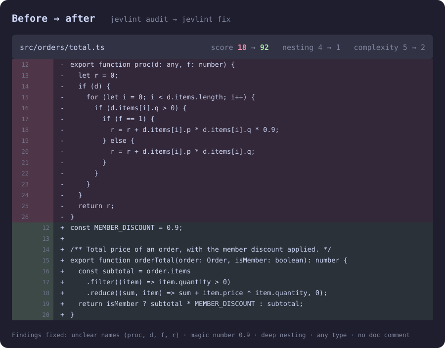

<p align="center">
  <a href="README.ja.md">日本語</a> · <b>简体中文</b> · <a href="README.md">English</a>
</p>

<p align="center">
  <a href="#立即试用"></a>
</p>

<p align="center">
  <a href="https://www.npmjs.com/package/@indxjp/jevlint"></a>
  <a href="https://github.com/INDXDev/jevlint/actions/workflows/ci.yml"></a>
  
  
  <a href="LICENSE"></a>
</p>

<p align="center">
  <a href="docs/getting-started.md"><b>入门</b></a> &nbsp;·&nbsp;
  <a href="docs/cli.md"><b>CLI</b></a> &nbsp;·&nbsp;
  <a href="docs/presets.md"><b>预设</b></a> &nbsp;·&nbsp;
  <a href="docs/agents.md"><b>编码智能体</b></a> &nbsp;·&nbsp;
  <a href="docs/README.md"><b>文档</b></a>
</p>

# jevlint

**一个基于模型的 linter，告诉你应该先重构什么。**

ESLint 告诉你某一行违反了规则。jevlint 读取仓库中的每个文件，按你选定的原则为其整洁程度打分，
然后给你一份排序列表：最混乱、改动最频繁的文件排在最前。接着它会写好提示词，让 Claude Code 或
Codex 去修复它们。

<p align="center">
  
</p>

<p align="center"><sub>基于虚构文件的示例。</sub></p>

## 立即试用

无需安装，无需 API key，代码也不会离开你的机器：

```sh
npx @indxjp/jevlint --ast-only
```

## 安装

```sh
npm install -g @indxjp/jevlint     # 或：pnpm add -g @indxjp/jevlint
jevlint --version
```

需要 Node.js 24.22.1 或更高版本（若使用 22 或 26 版本线，则需 22.23.4 或 26.12.1 及以上）。

## 实际效果

一个团队接手了 `shop-api`，只有一个下午用来清理代码。jevlint 选出文件、说明原因、交给
Claude Code 处理，并确认分数确实提高了。

<p align="center">
  
</p>

<p align="center"><sub>在虚构项目上的模拟运行。<a href="docs/assets/demo/demo.tape">录制脚本</a>。</sub></p>

## 有何不同

- **两种判断方式。** AST 分析衡量可度量的指标，例如复杂度和嵌套深度。
  [决策模型](docs/concepts.md#decision-models)回答需要判断的问题，例如“这些命名是否有意义？”
- **是决策模型，不是聊天机器人。** 像 [TypeSafe AI 的 Jev](https://typesafe.ai) 这样的模型返回的是
  经过校准的分数和概率，而不是一段文字。因此它快速、便宜，结果也可以排序和缓存。
- **一份排名，而不是满屏警告。** 文件按混乱程度、git 变更频率和大小排序，排在第一位的就是最值得
  你花时间的那个。
- **既能审查仓库，也能审查变更。** `jevlint pr` 和 `jevlint commits` 显示文件在变更前后的分数，
  只列出这次变更让情况变差的部分。`--intent` 还会对照提交信息和你的 `AGENTS.md` 检查变更。
- **用一句话写出自己的规则。** ast-grep pattern 选出代码，一个是/否问题判断每个匹配，
  这样模型的结论就能对应到行号。
- **覆盖大多数源代码语言。** TypeScript、JavaScript、Python、Go 和 Rust 可获得精确指标。其他语言
  可获得[近似指标](docs/scoring.md#languages-without-a-grammar)，无需额外安装。
- **原则即预设。** 依据知名软件工程书籍中的思想进行审计，或用几行 TOML 编写你自己的原则。
- **分数可以定下来。** `jevlint-score` 注释可以附带理由固定一个已接受的分数，免得有人为了刷分而改代码。
  参见 [Pinning scores](docs/scoring.md#pinning-scores)。
- **为编码智能体准备就绪。** `jevlint prompt | claude -p`，或让 `jevlint fix` 运行智能体。
  附带 [Claude Code 插件](#用编码智能体修复)和一个编辑 hook。
- **同一个答案只付费一次。** 结果按内容缓存，并可通过
  [S3 兼容存储桶](docs/caching.md#share-the-cache-through-object-storage)在 CI 和团队之间共享。

## 它不是什么

- **不是你现有 linter 的替代品。** ESLint、Ruff、Clippy 和类型检查器能精确判定的事情，继续交给它们。
  jevlint 对它们无法判断的部分进行排序。
- **不是最终裁决。** 模型分数是经过校准的意见。不同模型之间会有差异，模型版本更新时也可能变化。
  因此请把它们当作需要人来审阅的候选项，在 CI 中固定模型版本，并用
  [`jevlint test`](docs/presets.md#testing-a-question) 发现问题的答案何时发生漂移。
- **一旦启用 provider，默认就不是私密的。** 除 `--ast-only` 外，所有操作都会把代码发送到你配置的
  provider。参见[运行之前](#运行之前)。

## 快速开始

```sh
jevlint auth set typesafe   # 存储一次 key，按用户保存
jevlint init                # 在此仓库中创建 jevlint.toml
jevlint audit --dry-run     # 查看将发送哪些内容，不向 provider 发送请求
jevlint audit               # 对整个代码库排序
```

没有 TypeSafe 访问权限？[使用其他 provider](docs/providers.md)，例如 `openai`、`cloudflare` 或
`gateway`。

## 用编码智能体修复

```sh
jevlint prompt --top 3 --copy      # 粘贴到任意智能体
jevlint prompt | claude -p         # 或通过管道传入
jevlint fix --agent claude         # 或直接运行智能体，然后重新评分
jevlint quickfix --agent claude    # 或只让它在几轮内编辑文件，然后显示差异
```

在 Claude Code 中安装插件，即可获得一个 skill，以及 `/jevlint:audit`、`/jevlint:explain` 和
`/jevlint:review`。其编辑 hook 默认关闭，需要你手动开启：

```text
/plugin marketplace add INDXDev/jevlint
/plugin install jevlint@jevlint
```

参见 [Coding agents](docs/agents.md)。

## 让文档与代码保持一致

`jevlint spec` 把你的文档转换为检查清单，然后据此检查代码和文档：

```sh
jevlint spec compile --copy   # 给智能体的提示词：根据文档编写 .jevlint/spec
jevlint spec check            # 哪些文件违反了某个条目，哪些条目没有任何实现
jevlint spec drift            # 文档与检查清单不一致的地方
```

检查清单是两级 YAML：一份项目级清单，以及每个功能各一份。每个文件先被分配到所属功能，再只按该功能的
条目进行判断。参见 [Spec-driven development](docs/spec-driven-development.md)。

## 编写自己的规则

ast-grep pattern 决定检查哪些代码。一个问题决定它是否有问题，回答“是”即为违规。每处命中都会报告在
对应行上：

```toml
# jevlint.toml
[[rules]]
id = "catch-hides-failure"
language = "typescript"
pattern = "try { $$$ } catch ($E) { $$$ }"
question = "Does this catch block swallow a failure the caller needed to know about?"
message = "This catch hides a failure"
fix = "Rethrow it, or return an error the caller must handle."
threshold = 0.8   # 可选：概率达到或超过此值时报告
```

每个匹配对应一次 provider 请求，每条规则每个文件最多 `max_rule_matches` 次，`--ast-only` 会跳过规则。
参见 [Semantic rules](docs/presets.md#semantic-rules)。

用 `good-*` 和 `bad-*` fixture 证明预设问题有效，并捕获让结果发生变化的模型更新：

```sh
jevlint test            # 每个 fixture 都必须落在正确的一侧
jevlint test --record   # 保存今天的答案
jevlint test --drift    # 重新提问，列出发生变化的部分
```

## 审查变更

```sh
jevlint pr --ast-only                # 当前分支的 pull request 让哪些地方变差了
jevlint pr 42 --ast-only             # 同上，按编号指定
jevlint commits --count 5 --ast-only # 同上，逐个 commit
jevlint commits --count 5 --intent   # 同时对照 diff 检查每条提交信息和 AGENTS.md
```

你的工作区保持不变，生效的是你自己的配置，而不是变更中的配置。`--intent` 从 base commit 读取仓库的
指令，因此变更无法改写评判它的标准。参见 [CLI reference](docs/cli.md#jevlint-pr-number)，以及
[Continuous integration](docs/ci.md#review-what-a-pull-request-changes)，了解如何在每个 pull request 上运行它。

在提交之前捕获退化，无需 key，也无需网络：

```sh
jevlint init --pre-commit   # 阻止让文件比 HEAD 更差的提交
```

## 分数过低时让 CI 失败

```toml
# jevlint.toml
[scoring]
fail_under = 60    # 低于此值时以 1 退出
```

对于遗留代码库，可以只针对新增问题设置关卡，而不是针对分数：

```sh
jevlint baseline --ast-only                      # 提交 .jevlint/baseline.json
jevlint audit --new --ast-only --format github   # 出现任何新问题时以 1 退出，并输出为 PR 注解
jevlint audit --ast-only --format sarif > jevlint.sarif   # 用于代码扫描
```

参见 [CI](docs/ci.md)。

## 相关项目

Jev 让构建 linter 变得顺理成章，已有多人各自独立做了一个。以下项目均与本项目无关。它们回答的是不同的
问题，请按需求选择：

| 项目 | 判断单位 | 适用场景 |
| --- | --- | --- |
| **@indxjp/jevlint**（本项目） | 整个文件，并排序。可选的逐匹配规则 | 想在整个仓库范围内、依据具名原则，知道先重构什么 |
| [jev-lint](https://github.com/mizchi/jev-lint) | 一个 ast-grep 匹配，一句话 | 想要大量内置规则及拟合好的阈值，用于发现与自身注释和命名相矛盾的代码 |
| [@hazymoon/jevlint](https://github.com/Ice-Hazymoon/jevlint) | 每个问题一条规则，写在 TypeScript 配置中 | 想要带豁免机制的手写审查规则，以及衡量召回率的变异测试 |
| [@phox-js/jevlint](https://github.com/Fox-Islam/jevlint) | 一个 Jev 查询 | 想检查发送给 Jev 的查询，而不是你的代码。也支持 PHP 和 Python |
| [@diffpal/jevlint](https://www.npmjs.com/package/@diffpal/jevlint)，现为 [LintPal](https://github.com/diffpal/lintpal) | Git 比较中的变更行 | 想把团队的 Markdown 规则作为 pull request 检查 |

本项目的 baseline、SARIF 输出、fixture、漂移检查和提交信息检查都借鉴了上面前两个项目。jevlint、
jev-lint 和 @hazymoon/jevlint 都使用 [ast-grep](https://ast-grep.github.io) 读取代码。

## 参考

<details>
<summary><b>命令</b></summary>

| 命令 | 作用 |
| --- | --- |
| `jevlint audit [paths...]` | 为文件评分并排序。也是默认命令。 |
| `jevlint explain <file>` | 显示单个文件的全部问题和分数。 |
| `jevlint architecture [paths...]` | 审查代码库、目录和类，并从最差到最好排序。 |
| `jevlint pr [number]` | 审查 GitHub pull request 的变更：变更前后的分数，以及哪些地方变差了。 |
| `jevlint commits [revision]` | 以同样方式从 `HEAD` 向前逐个审查 commit。 |
| `jevlint baseline [paths...]` | 记录当前的问题，使 `audit --new` 只报告新增问题。 |
| `jevlint test [questions...]` | 运行预设 fixture，记录其答案，并检测漂移。 |
| `jevlint hook` | 报告一次编辑或暂存的变更让哪些地方变差，供智能体和 pre-commit 使用。 |
| `jevlint spec compile\|check\|drift\|list` | 规范驱动开发：把文档编译为检查清单，再据此检查代码和文档。 |
| `jevlint prompt [files...]` | 打印或复制给编码智能体的修复提示词。 |
| `jevlint fix [files...] --agent <name>` | 对最差的文件运行智能体，然后重新评分。 |
| `jevlint quickfix [files...] --agent <name>` | 让智能体在几轮内只编辑最差的文件，然后显示差异。 |
| `jevlint init` | 创建仓库级或用户级配置。 |
| `jevlint auth set\|list\|remove\|env` | 管理 API key。 |
| `jevlint preset [list\|show\|default\|new\|edit\|add\|remove]` | 选择、查看、编写和管理原则预设。不带参数时打开菜单。 |
| `jevlint cache info\|clear` | 查看或清空结果缓存。 |
| `jevlint config show\|path` | 显示合并后的配置及其来源。 |

</details>

<details>
<summary><b>配置</b></summary>

```toml
# jevlint.toml
presets = ["readable-code", "solid"]
include = ["src/**"]
exclude = ["**/*.generated.ts"]

[provider]
name = "typesafe"
model = "jev-latest"

[scoring]
scale = 100        # 设为 1 则分数范围为 0 到 1
fail_under = 60    # 低于此值时以 1 退出，用于 CI

[weights]
"readable-code.naming" = 3   # 更重视这一项
"solid.dependency-inversion" = 0   # 关闭这一项
```

</details>

<details>
<summary><b>内置预设</b></summary>

| 预设 | 关注点 |
| --- | --- |
| `full` | 默认值：包含下面所有预设，每个文件一次请求共 97 个问题 |
| `readable-code` | 命名、注释、控制流、理解所需时间 |
| `clean-code` | 短小的函数、单一抽象层级、诚实的错误处理 |
| `solid` | 五个面向对象设计原则 |
| `software-design` | 深模块、信息隐藏、复杂度管理 |
| `code-smells` | 经典的重构坏味道 |
| `clean-architecture` | 依赖方向、边界、框架无关性 |
| `kiss-dry-yagni` | 简单性、重复、投机性代码 |
| `security` | 输入校验、注入、密钥、访问检查、安全失败 |
| `documentation` | 文件用途、公共代码的文档注释、明确的契约、准确的文档 |
| `bug-hunt` | 来自 CWE 等分类体系的 43 类已知缺陷，用于定位 bug 藏身之处 |

预设用我们自己的语言转述了公开讨论过的原则。它们与原作者或出版方无关，也未获其认可。
参见 [docs/presets.md](docs/presets.md)。

</details>

## 文档

从[文档索引](docs/README.md)开始。

- [入门](docs/getting-started.md)
- [概念](docs/concepts.md)
- [CLI 参考](docs/cli.md)
- [配置](docs/configuration.md)
- [Provider](docs/providers.md)
- [预设](docs/presets.md)
- [评分](docs/scoring.md)
- [架构审查](docs/architecture-review.md)
- [规范驱动开发](docs/spec-driven-development.md)及 [spec 参考](docs/spec-reference.md)
- [编码智能体](docs/agents.md)
- [缓存](docs/caching.md)
- [持续集成](docs/ci.md)
- [JSON 输出](docs/json-output.md)
- [安全与隐私](docs/security.md)
- [故障排查](docs/troubleshooting.md)
- [架构](docs/architecture.md)及[代码参考](docs/code-reference.md)

## 运行之前

一次 audit 会把你的源文件内容发送到你配置的 provider。如果代码是机密的，请先阅读
[Security and privacy](docs/security.md)。`audit --ast-only` 从不访问网络。

## 贡献

参见 [CONTRIBUTING.md](CONTRIBUTING.md)。如需报告漏洞，请参见 [SECURITY.md](SECURITY.md)。

## 许可证

[MIT](LICENSE)

jevlint 是一个独立的开源项目，与 TypeSafe AI、Cloudflare、Microsoft、OpenAI、Vercel 或 Anthropic
均无关联，也未获其认可。所有产品名称均为其各自所有者的财产。
